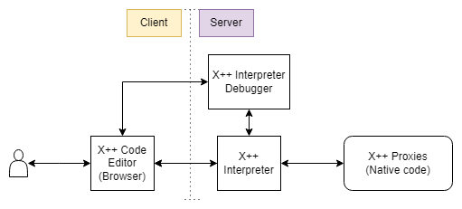
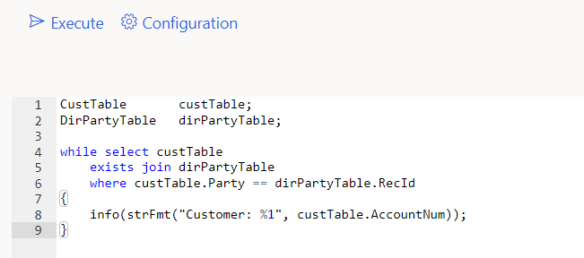
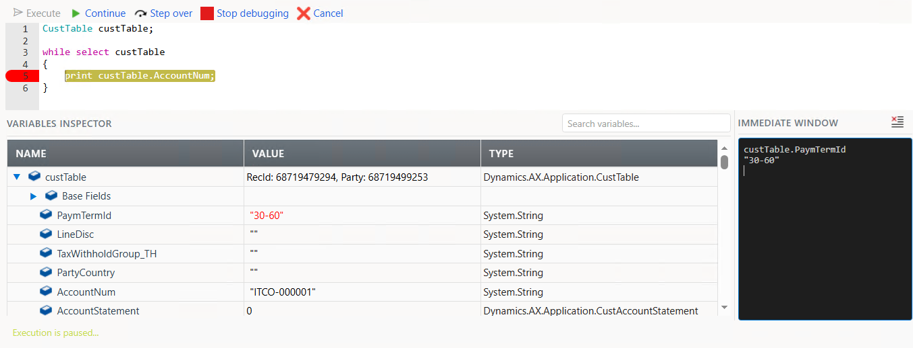
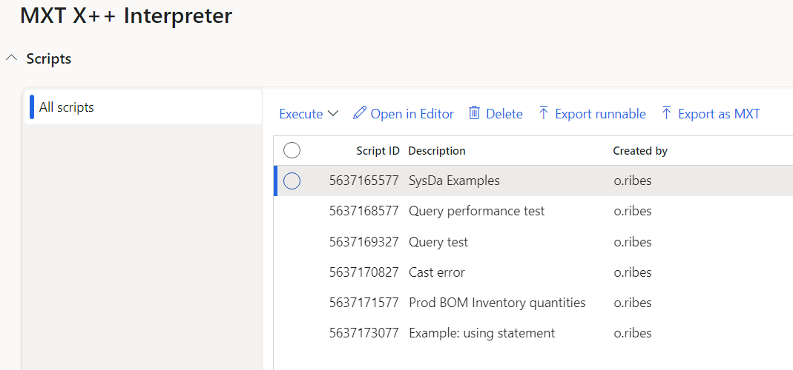

<h1 align="center">MXT - X++ Interpreter (preview)</h1>

 > **_IMPORTANT:_** It is **not recommended** for Production scenarios as this tool allows you to execute code without guarantee.

This tool allows you to write, execute and debug X++ code directly in the browser, without the need to compile or wait for service restart.

## Getting started
1. Clone the repo
2. Execute `Initialize.ps1` script as *Administrator*. This will create a symbolic link into your *LocalPackageDirectory*
3. Build and synchronize the **MXppTools** model
4. Navigate to System Administration > Workspaces > **MXT - X++ Interpreter**

# Interpreter
This tool generates bytecode that is later interpreted directly during execution. The instructions that are interpreted are executed in native code using a series of proxies written in X++. That allows to simulate the execution *almost* exactly as native code would do it, without the need to compile.



### Code editor
The editor will highlight the reserved words and will indicate you which statement is being executed when debugging. It will also tell you if your code has any syntax error.

Some keyboard shortcuts are implemented to easily execute, insert a breakpoint, step over and continue debugging. These can be found as standard shortcuts by Right click > View shortcuts on the editor.


The variable inspector will allow you to take a look to the variables that are currently on scope and will let you modify the values for primitive types. Using the immediate window, you will be able to execute X++ expressions while debugging.


### Script repository
You can save X++ scripts into the built-in repository to later execute them.


# Use cases
* Execute, modify and save X++ scripts
* Experiment with unknown or new functionality
* Test pieces of your code
* Get metadata information quickly (class and table ids, label texts, enum values...)

## Security
For development environments no additional security is needed, but if you run the script on a non-development system a user should have **MXT Script executor** role.

A script runs as the AOS process, and with .NET calls it can reach everything that process can: files, the network and the configuration of the environment. Give this role only to people who could deploy code to that environment.

## Limitations
* **Class declarations** are not supported
* On a line that uses a macro, the editor can't complete or show hints after the macro, because the columns of the expanded code are different

# .NET libraries
Scripts can use any .NET type the AOS can load: the framework, the assemblies in its `bin` folder and the references of the installed models. It follows the rules of the X++ compiler.

```cs
using Azure.Storage.Files.Shares;
using Models = Azure.Storage.Files.Shares.Models;

System.Threading.CancellationToken tokenNull;
System.Object objNull;

ShareClient share = new ShareClient(connectionString, 'myshare');
ShareDirectoryClient folder = share.GetRootDirectoryClient().GetSubdirectoryClient('Archive');

var items = folder.GetFilesAndDirectories(objNull, tokenNull);
var enumerator = items.GetEnumerator();

while (enumerator.MoveNext())
{
    Models.ShareFileItem item = enumerator.Current as Models.ShareFileItem;
    info(strFmt('%1 %2', item.Name, item.FileSize));
}
```

| Feature | Example |
| --- | --- |
| Full names and `using` | `System.IO.File::Exists(path)`, `using System.IO;`, `using IO = System.IO;` |
| Overloads, optional parameters, `params` | chosen with the same rules as compiled X++ |
| `byref` | `System.Int32::TryParse('5', byref value);` |
| Generics | `System.Collections.Generic.List<str> names = new System.Collections.Generic.List<str>();` |
| Arrays | `System.String[] a = new System.String[2](); a.SetValue('x', 0);` |
| Typed catch | `System.Exception ex; try { ... } catch (ex) { ... }` |
| `using` statement | `using (var writer = new System.IO.StringWriter()) { ... }` |
| Methods of X++ classes that use .NET types | `ShareClient share = MyClass::getShare();` |

The editor completes namespaces, types and members, shows every overload of a method, and the debugger shows the properties of a .NET object.

Things that surprise people, because compiled X++ does them too:
* Type names and namespaces are case sensitive. Member names are not.
* `if (obj)` on a .NET object means *not null*, even when the object is a `Response<bool>` with the value `false`. `boolean b = obj;` does apply its implicit conversion. So `if (file.Exists(token))` is always true: assign it to a `boolean` first.
* A catch block with `Exception::CLRError` or `System.Exception` also catches the X++ errors of the code it calls.

# Development
The C# source of the interpreter is in `Projects\XppInterpreter`, and the X++ classes it talks to are in the **MXppTools** model. `Scripts\BuildInterpreter.ps1` builds the DLL, copies it to the package and restarts IIS. Add `-IncludeModel` when X++ code changed, or the C# classes X++ calls did.

## Build dependencies
Every assembly the X++ code names, directly or through a type it uses, has to exist where the model is compiled. A build server has fewer assemblies than a development VM, so a reference that compiles on the VM can break the build of every client. For that reason `XppInterpreter.dll` references only the framework, and code that needs another assembly finds it by name at run time, as `Core\Clr\AosMetadata.cs` does. `BuildDependencyTests` fails when a new reference appears.

## Tests
```
dotnet test Projects\XppInterpreter.Tests
```
They run the real lexer, parser, bytecode generator and interpreter against a fake of the D365 proxies, so they need no environment.

`Conformance\conformance.txt` holds X++ snippets with the value the **real X++ compiler** gave for each one. It is the specification: when the compiler and the documentation disagree, the compiler wins. The snippets that need real D365 types are marked `[D365]` and run only on an environment, with `Conformance\conformance-tool.js`:

```
node conformance-tool.js compiled <AxClass folder of a model>      writes the snippets as an X++ class for the compiler
node conformance-tool.js update                                    keeps what the compiler gave as the expected values
node conformance-tool.js interpreted <AxClass folder of a model>   writes a class that runs them through the interpreter
node conformance-tool.js compare                                   shows the differences
```

After `compiled` or `interpreted`, compile that model, restart IIS and open `/?mi=SysClassRunner&cls=DEVXppProbe` or `cls=DEVXppConformance`. The generated classes are not part of any project: remove them when you finish.

# Build Action
The GitHub build action is based on [FSC-PS for GitHub](https://github.com/fscpscollaborative/fscps).

# Build Status
[](../../actions/workflows/build.yml)
